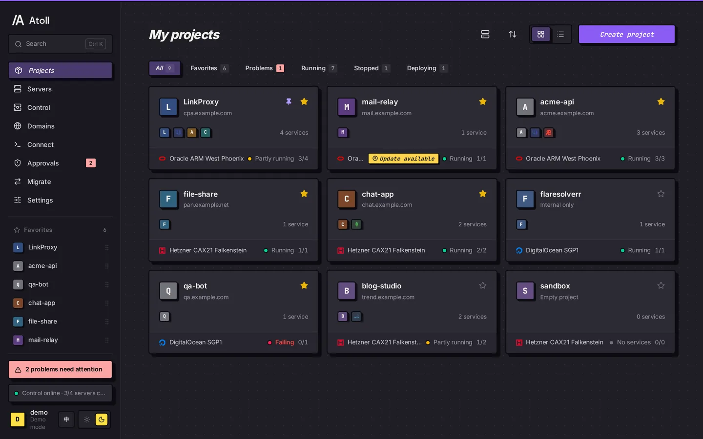
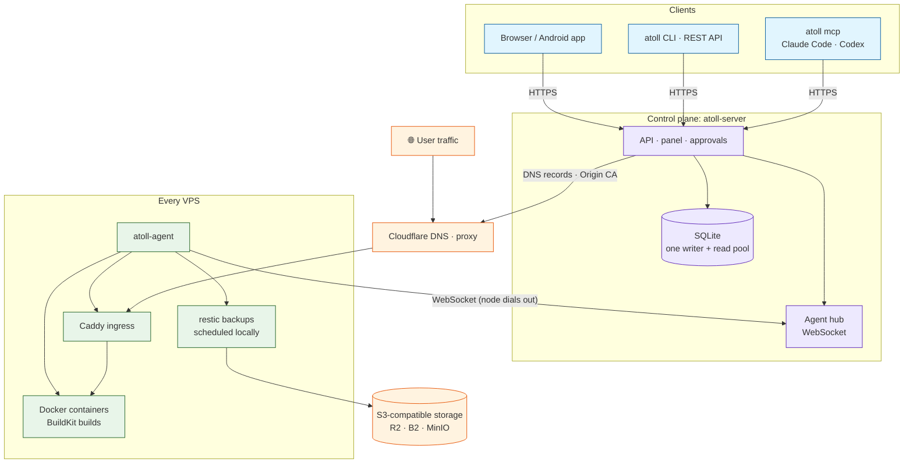
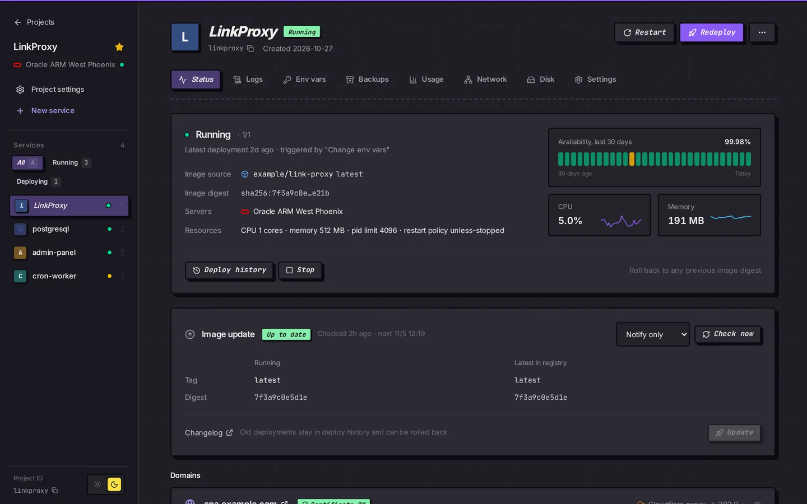
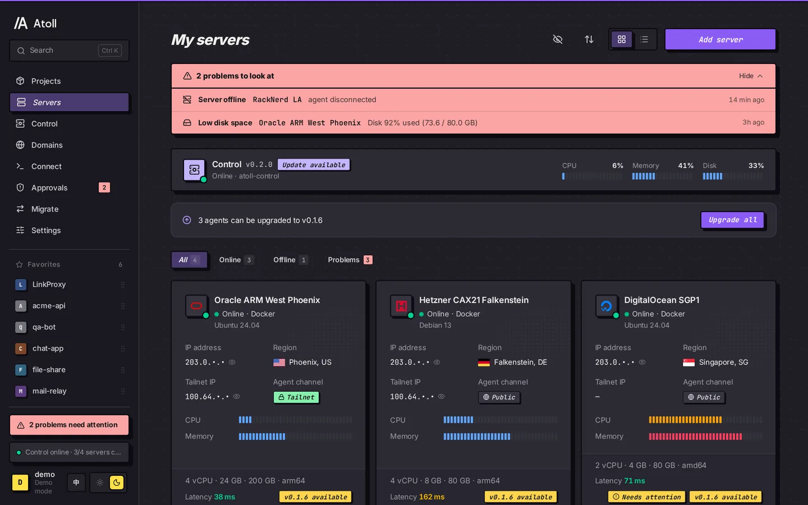
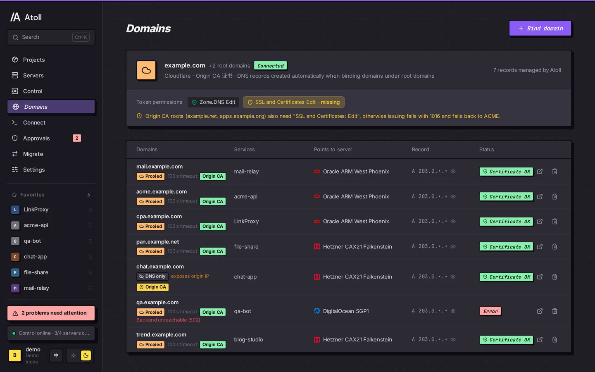
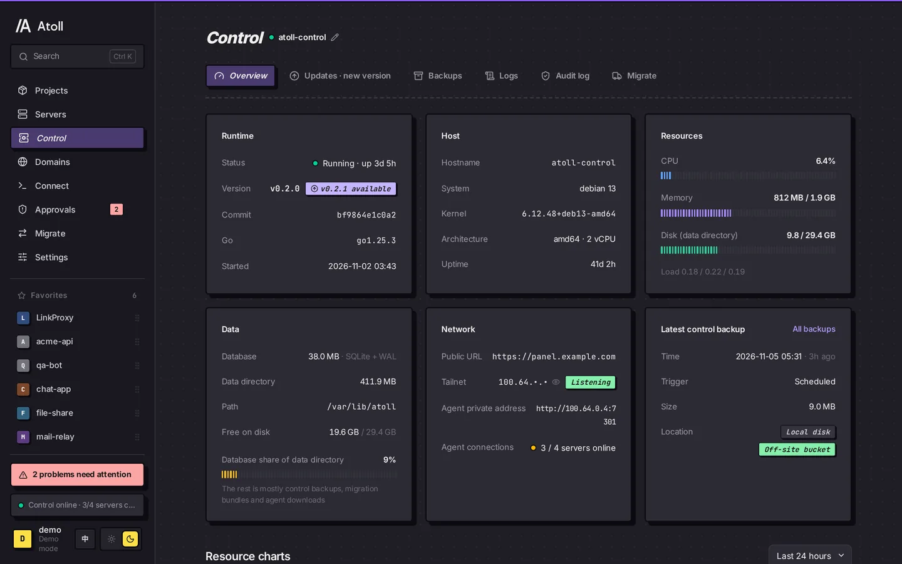
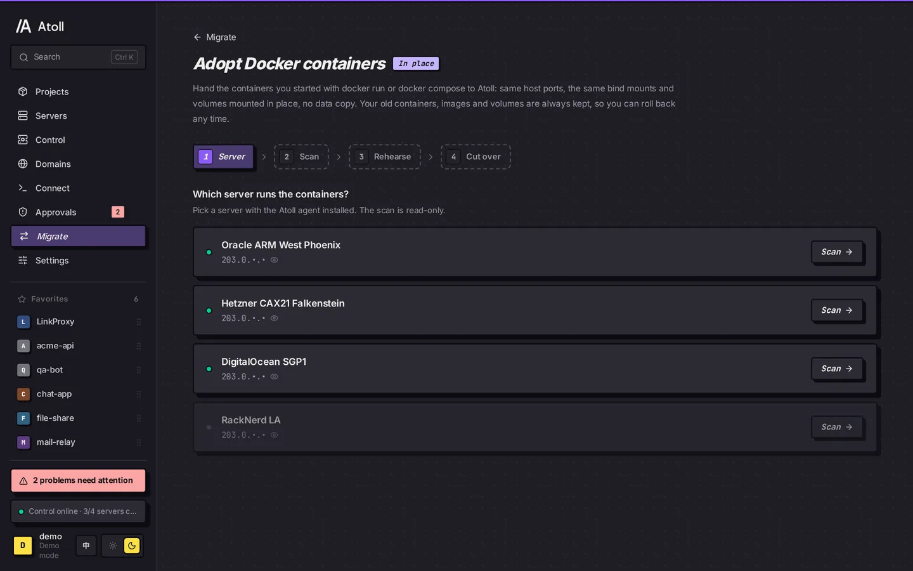
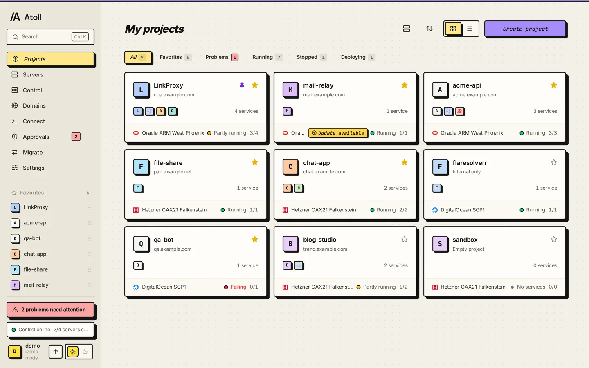

<p align="center">
  
</p>

<h1 align="center">Atoll</h1>

<p align="center">
  <strong>A self-hosted container panel for many VPSes: one lightweight control plane + one agent per machine + plain Docker</strong>
</p>

<p align="center">
  <a href="./README.md">简体中文</a> | English
</p>

<p align="center">
  <a href="https://github.com/Sakuralaaa/Atoll/releases"></a>
  <a href="./go.mod"></a>
  <a href="./web/package.json"></a>
  
  <a href="./android/README.md"></a>
  <a href="./LICENSE"></a>
</p>

<p align="center">
  
</p>

> [!NOTE]
> **Status: pre-alpha.** Builds and tests pass in CI (including `-race`), but Atoll has not been proven in large production deployments. Try it on workloads that don't matter yet, and turn on backups.

> [!TIP]
> If you know Zeabur, it will feel familiar: deploy from an image or a GitHub repo, and manage domains, environment variables, volumes, backups and migrations in a UI. Services already running on Zeabur, or started with your own `docker run`, can be [adopted in place](#migrate-and-adopt).

## Contents

- [Overview](#overview)
- [Screenshots](#screenshots)
- [Quick start](#quick-start)
- [Migrate and adopt](#migrate-and-adopt)
- [Running many machines](#running-many-machines)
- [Building services from source](#building-services-from-source)
- [Security](#security)
- [Day-to-day operations](#day-to-day-operations)
- [Verifying downloads](#verifying-downloads)
- [Android app](#android-app)
- [Development](#development)
- [Documentation](#documentation)

## Overview

Atoll has three parts: the control plane `atoll-server` (API + embedded panel + SQLite), an `atoll-agent` on every VPS, and the `atoll` CLI / MCP server for people and AI tools. Agents dial out to the control plane over WebSocket, so nodes open no inbound ports. User traffic goes through each machine's own Caddy straight to the containers, so **your services keep running when the control plane is offline**.

### Architecture



The control plane schedules and records; deploys, builds and backups run on the nodes. Optionally, Tailscale puts control-to-node and cross-machine service traffic on a private network.

### Features

| Area | What you get |
| :-- | :-- |
| Deploy | Images from Docker Hub / GHCR / private registries; builds from GitHub repos (auto-deploy on push webhook); env vars that reference other services; volumes, ports, domains; one-click rollback; zero-downtime deploys for services without volumes or host ports; new services default to a 1024 MB memory limit |
| Templates | PostgreSQL / MySQL / Redis / MongoDB |
| Traffic | Caddy ingress on every machine; multiple root domains; Cloudflare records created when you bind a subdomain, one-click proxied / DNS-only, Origin CA or ACME certificates |
| Migration | Move services between machines (volumes + database dump and restore); adopt Zeabur projects in place; adopt containers started with `docker run` / compose |
| Backups | restic straight to any S3-compatible bucket, logical database dumps + volume snapshots; scheduled on each node, so backups run even with the control plane offline; restore to a different machine |
| Updates | Image update detection (digest and newer semver tags), notify only or auto-update in a time window; one-click control plane and agent upgrades with automatic rollback |
| Control plane | Its own status, logs and audit trail; daily encrypted backups; move it to a new machine with one command, without stopping your services |
| Panel | Chinese and English, dark and light themes; favorite, pin and drag-sort projects; sidebar order saved per account; custom avatar; `Ctrl K` command palette; problems surfaced in one place |
| Automation | `atoll` CLI, REST API, `atoll mcp`; fine-grained, project-scoped tokens; dangerous operations can require approval in the panel |
| Security | Two-factor auth, brute-force lockout, session management, CSP / HSTS; releases ship SHA256SUMS and build provenance |

## Screenshots

<table>
  <tr>
    <td width="50%"><p align="center"><sub>Service: status, 30-day availability, resource charts, image updates</sub></p></td>
    <td width="50%"><p align="center"><sub>Servers: online state, resources, latency, one-click agent upgrade</sub></p></td>
  </tr>
  <tr>
    <td width="50%"><p align="center"><sub>Domains: Cloudflare proxy, certificate state, token permission check</sub></p></td>
    <td width="50%"><p align="center"><sub>Control plane: version, host, database and latest backup</sub></p></td>
  </tr>
  <tr>
    <td width="50%"><p align="center"><sub>Adopt Docker containers: pick a server → scan → rehearse → cut over</sub></p></td>
    <td width="50%"><p align="center"><sub>Light theme</sub></p></td>
  </tr>
</table>

> Screenshots come from the panel's built-in demo mode (`?demo=1`); all data is made up.

## Quick start

You need Debian / Ubuntu (amd64 or arm64), root, and a domain pointing at the control plane.

**1. Install the control plane** (`--domain` installs Caddy and gets a Let's Encrypt certificate; the panel itself listens on 127.0.0.1 only):

```bash
curl -fsSL https://raw.githubusercontent.com/Sakuralaaa/Atoll/main/install/install-server.sh \
  | sudo sh -s -- --domain panel.example.com
```

Open `https://panel.example.com`, create the admin account, then turn on two-factor auth under Settings → Security.

**2. Add machines**: copy the command from Servers → Add in the panel and run it on each VPS. It carries a one-time token (valid for 1 hour) and the SHA-256 of the agent binaries the control plane serves:

```bash
curl -fsSL https://raw.githubusercontent.com/Sakuralaaa/Atoll/main/install/install-agent.sh | sudo sh -s -- \
  --server https://panel.example.com --token atl_join_xxx --sha256-amd64 … --sha256-arm64 …
```

To remove a node: `curl -fsSL …/install-agent.sh | sudo sh -s -- --uninstall`. This stops and removes the agent and keeps containers and data; add `--purge` to also remove Atoll's containers and networks. Data in `/var/lib/atoll` is always kept; delete it by hand when you no longer need it. Then remove the server in the panel.

**3. Deploy your first service**: create a project in the panel, pick a machine, enter an image (e.g. `nginx:1`) and a port, then bind a domain. With Cloudflare configured, the DNS record is created for you.

## Migrate and adopt

| From | How | Docs |
| :-- | :-- | :-- |
| Zeabur | Scan → import → rehearse → cut over, reversible, then uninstall k3s | [docs/migrate-from-zeabur.md](docs/migrate-from-zeabur.md) |
| Your own `docker run` / compose containers | Same ports, data mounted in place, old containers kept for rollback | [docs/adopt-docker.md](docs/adopt-docker.md) |
| Between machines in Atoll | Service migration: volumes + database dump and restore | [docs/api.md](docs/api.md) |
| The control plane itself | One command to move it to a new machine, services keep running | [docs/control.md](docs/control.md) |

In the panel, it's Migrate in the sidebar.

## Running many machines

Once you have more than a few machines, these matter most:

- **Adding machines**: use a fresh command from the panel for each (tokens are one-time). The `--sha256-*` flags make the script verify the binary before running it, so a man in the middle can't swap it even if the control plane URL is plain http.
- **Machines going offline**: agents reconnect on their own. Containers are managed by Docker, so restarting the agent doesn't touch running services. The Servers page shows online state and resource charts.
- **Control plane load**: metrics and events from a dozen machines all go into the control plane's SQLite. Writes go through a single connection; panel lists, metrics and audit queries use a separate read-only pool, so writes never block them.
- **Build isolation**: each machine runs one build at a time, with a memory cap and low CPU weight, so builds can't starve services on the same box (see the next section).
- **Backups**: configure one S3-compatible bucket under Settings → Backups, shared by all machines. If a machine dies, restore its backups onto another.
- **Cross-machine access**: with Tailscale on, services can reach services on other machines by name, on ports `41000–41999` (`ATOLL_MESH_PORTS`).

### Private network (Tailscale, optional)

The panel stays on public HTTPS; only the control plane and nodes need Tailscale, not your own computer. If your computer runs Tailscale together with Clash TUN, add `IP-CIDR,100.64.0.0/10,DIRECT` to your rules.

1. In the Tailscale admin console: add `"tag:atoll": ["autogroup:admin"]` to the ACL's `tagOwners`, allow `tag:atoll` → `tag:atoll:7301,41000-41999`, and create an auth key that is **reusable, non-ephemeral, pre-approved, tagged `tag:atoll`**.
2. Control plane: `install-server.sh --domain panel.example.com --tailscale-authkey tskey-auth-xxx [--agent-tailnet-only]`, then choose Tailscale under Settings → Private network in the panel and enter the same key. Use the control plane's **100.x IP** as its tailnet address (nodes run with `--accept-dns=false` and can't resolve MagicDNS names).
3. Nodes: run the add command as usual. The script installs Tailscale and joins over the tailnet, keeping the public address as a fallback. If the tailnet isn't reachable it warns and uses the public address; switch later with Servers → Join tailnet or `atoll-agent tailnet up`.

With `--agent-tailnet-only` (`ATOLL_AGENT_TAILNET_ONLY=1`), every public `/agent/*` request gets a 404 (except `/agent/v1/bootstrap`). If you run your own Caddy, do the same there. See [docs/api.md](docs/api.md#private-network-tailscale).

## Building services from source

```bash
atoll deploy --git https://github.com/OWNER/REPO [--branch main] [--context DIR] [--dockerfile F] \
  [--build-arg K=V] [--git-token-env GH_TOKEN] -p PROJECT
atoll logs SERVICE --build -f
```

Builds run on the machine that hosts the service, never on the control plane. A new service prints its GitHub webhook URL and secret once, at creation (`atoll services webhook SERVICE` shows the URL again). A push delivered more than once (GitHub retries or redeliveries) builds only once.

**Resource limits**: by default builds run in a dedicated BuildKit container (buildx `docker-container` driver), capped at 75% of the machine's memory with a quarter of a normal container's CPU weight: it can use the whole CPU when idle and yields to services when busy. A build is refused when less than 3 GiB of disk is free, and the build cache is pruned to 10 GB after every build. Without buildx, or when the `moby/buildkit` image can't be pulled, it falls back to plain `docker build` and says so in the build log.

To change these, create `/etc/atoll/agent.env` on the node and run `systemctl restart atoll-agent`:

| Variable | Default | Meaning |
| --- | --- | --- |
| `ATOLL_BUILD_LIMITS` | on | `off` uses plain `docker build` with no limits |
| `ATOLL_BUILD_MEMORY` | 75% of memory (at least 1 GiB) | Build memory cap, e.g. `2g`, `1536m` |
| `ATOLL_BUILD_CPUS` | no hard cap | Hard CPU cap, e.g. `1.5` |
| `ATOLL_BUILD_MIN_FREE_GB` | `3` | Refuse to build below this much free space; `0` skips the check |
| `ATOLL_BUILD_CACHE_GB` | `10` | Build cache kept after each build; `0` never prunes |
| `ATOLL_BUILD_CACHE_DAILY_GB` | `5` | Build cache kept by the daily cleanup; `0` skips daily pruning |
| `ATOLL_BUILDER_IDLE_STOP` | `10` | Minutes of idle before the builder container stops (cache is kept and it starts again on the next build); also accepts `90s`, `1h`; `0` never stops |
| `ATOLL_DOCKER_ROOT` | `/var/lib/docker` | Path used for the disk check |

**Cleanup**: deleting a service (or its project, or moving it away) removes that service's build images `atoll-build/<service ID>:*` and leftover build directories on that machine. The builder container stops after 10 idle minutes and holds no memory. A daily cleanup removes old `atoll-builder-*` builders left over from changed limits; if no service on the machine builds from source any more, it removes the current builder and its cache too (recreated on the next build); otherwise it prunes the cache to 5 GB.

On small machines with 1–2 GB of memory, set `ATOLL_BUILD_MEMORY=768m`, or build in CI and deploy images instead.

## Security

The panel can sit on the public internet, behind these layers:

- **HTTPS**: `--domain` (Caddy + Let's Encrypt) or your own TLS reverse proxy; the panel listens on 127.0.0.1 only. Session cookies are `HttpOnly` + `Secure` + `SameSite=Strict`, and writes check Origin. Panel pages send CSP, plus HSTS over HTTPS.
- **Sessions**: at most 30 days, expiring after 7 days unused. View and revoke them under Settings → Security.
- **Two-factor auth (TOTP)**: enable it under Settings → Security and keep the 10 one-time recovery codes. Enabling or disabling it signs out every other session.
- **Brute-force protection**: wrong passwords and codes are counted per IP and per account, with exponential lockout (up to 1 hour per IP, 15 minutes per account). Only `X-Forwarded-For` from a local reverse proxy is trusted; otherwise configure `--trusted-proxies`.
- **API tokens (`atl_pat_`)**: created only in the panel, not subject to 2FA; pick the least scope you need: `read`, `deploy`, `exec`, `delete`, `migrate`, `domains`, `restore`, `servers`, `settings`, `tokens`, optionally limited to projects. `exec` (run commands in containers) is its own scope; `deploy` doesn't include it. Tokens with `require_approval` need dangerous operations approved in the panel.
- **Nodes**: agents dial out; nodes open no inbound ports. Node tokens travel only in the `Authorization` header, never in URLs. `public_port` can't use 22, 7301, 41641 or 41000–41999.
- **Recovery**: forgot the password: `sudo atoll-server reset-password`; lost both phone and recovery codes: `sudo atoll-server admin reset-2fa <username>`. Both run on the control plane machine.

Details in [docs/api.md](docs/api.md#auth).

## Day-to-day operations

| Task | How |
| --- | --- |
| Upgrade the control plane | Control → Updates in the panel, or rerun `install-server.sh --version vX.Y.Z` |
| Upgrade agents | Upgrade all at the top of the Servers page, or Settings → Agent on one server; CLI `atoll servers upgrade-agent --all`. The binary is verified by SHA-256 before it's swapped; if the new agent doesn't reconnect within two minutes it rolls back, and containers aren't recreated. Agents older than v0.1.6 need the add command rerun once on the node (already-joined nodes skip the join step) |
| Back up and move the control plane | See [docs/control.md](docs/control.md) |
| Logs | `journalctl -u atoll-server -f`, `journalctl -u atoll-agent -f`, or the Control page in the panel |
| Free disk space | The last 3 build images are kept per service; use `docker system prune` for everything else |

## Verifying downloads

Every release ships `SHA256SUMS` plus GitHub-issued build provenance, proving the binaries were built by this repository's release workflow.

```bash
# check hashes
sha256sum -c SHA256SUMS --ignore-missing
# check provenance (needs the gh CLI)
gh attestation verify atoll-server-linux-amd64 --repo Sakuralaaa/Atoll
```

The install scripts check binaries downloaded from GitHub against `SHA256SUMS`, and agents downloaded from the control plane against the `--sha256-*` flags in the add command. Control plane self-updates check `SHA256SUMS` too and roll back on failure.

## Android app

[`android/`](android/) is a native Android shell app (Kotlin + Jetpack Compose, Android 8.0+): native sign-in (with 2FA and recovery codes; the password is encrypted with Android Keystore), the panel full screen, automatic re-login when a session expires, quick switching between panels, and file upload and download.

The APK is attached to every [GitHub Release](https://github.com/Sakuralaaa/Atoll/releases) (`atoll-android-<version>.apk`, with a `.sha256`); development builds from `main` are artifacts of the [android workflow](https://github.com/Sakuralaaa/Atoll/actions/workflows/android.yml). See [android/README.md](android/README.md).

## Development

```bash
# panel (npm run dev while developing; VITE_DEMO=1 uses the built-in demo data)
(cd web && npm ci && npm run lint && npm run build) && internal/server/webui/sync.sh
# backend
go build ./cmd/atoll-server ./cmd/atoll-agent ./cmd/atoll
go vet ./... && gofmt -l . && go test ./...
# install scripts
sh scripts/test-installers.sh
```

CI ([.github/workflows/ci.yml](.github/workflows/ci.yml)) runs gofmt, vet, `go test -race`, oxlint, the panel build, install script tests and govulncheck (warn only). Every action is pinned to a commit SHA. govulncheck currently reports only GO-2026-4887 and GO-2026-4883 in `github.com/docker/docker`, both daemon-side issues (AuthZ plugins, plugin privilege checks). Atoll only uses the client and isn't affected; both go away once it moves to `github.com/moby/moby/client`.

| Component | Path |
| --- | --- |
| Control plane (API + embedded panel) | `cmd/atoll-server`, `internal/server` (data layer in `internal/server/store`, migrations in `store/migrations`) |
| Node agent | `cmd/atoll-agent`, `internal/agent` |
| Shared types and agent protocol | `internal/api` (`types.go` for REST resources, `protocol.go` for WebSocket messages) |
| CLI / MCP | `cmd/atoll`, `internal/cli` |
| Web panel | `web/` (React + Vite + Tailwind, pages lazy-loaded per route) |
| Install scripts / systemd | `install/`, `deploy/` |

Contribution and review conventions are in [CONTRIBUTING.md](CONTRIBUTING.md). Before a release, write the notes and upgrade steps in `docs/releases/<tag>.md` (attached to the Release) and add a line to [CHANGELOG.md](CHANGELOG.md). Pushing a `v*` tag triggers the [release workflow](.github/workflows/release.yml), which builds, tests, packages, issues provenance and publishes the Release:

```bash
git tag v0.1.0 && git push --tags
```

## Documentation

- [docs/api.md](docs/api.md): REST API, agent protocol, scopes, backups, builds
- [docs/control.md](docs/control.md): control plane backups, self-update, migration, disaster recovery
- [docs/migrate-from-zeabur.md](docs/migrate-from-zeabur.md): migrating from Zeabur
- [docs/adopt-docker.md](docs/adopt-docker.md): adopting containers you started with Docker
- [docs/ui-guide.md](docs/ui-guide.md): panel UI conventions
- [CHANGELOG.md](CHANGELOG.md): release history

Most docs are written in Chinese.

## Community

Come chat and share feedback on [LINUX DO](https://linux.do).

## License

[AGPL-3.0](LICENSE). Some Kubernetes projection rules are ported from [zeabur-oss/zeabur](https://github.com/zeabur-oss/zeabur) (Apache-2.0); see [THIRD_PARTY_NOTICES.md](THIRD_PARTY_NOTICES.md).
