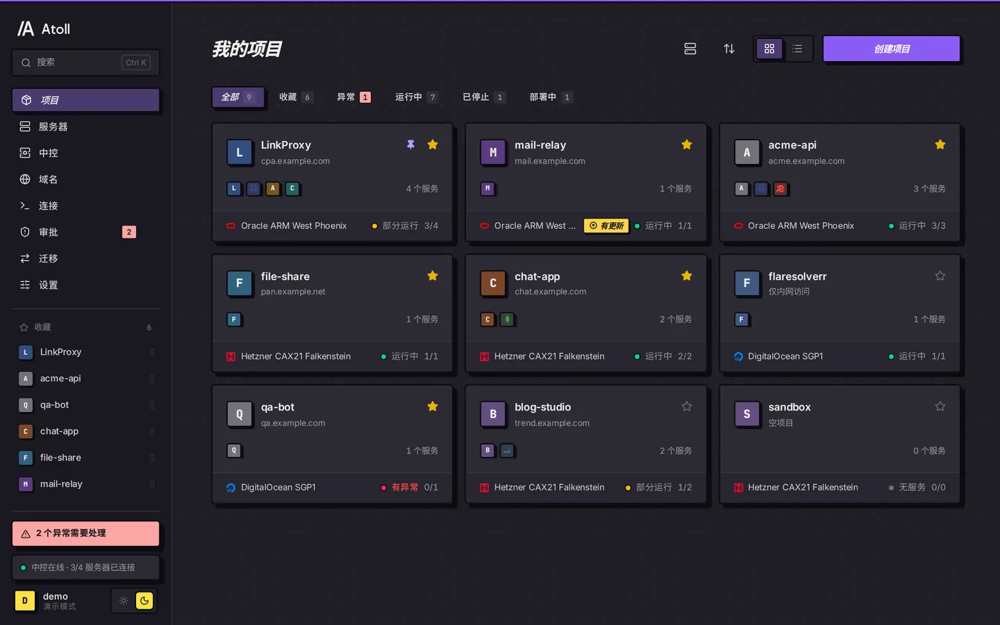
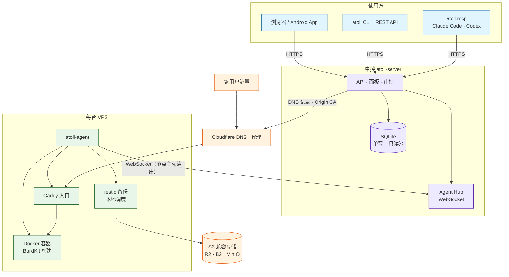
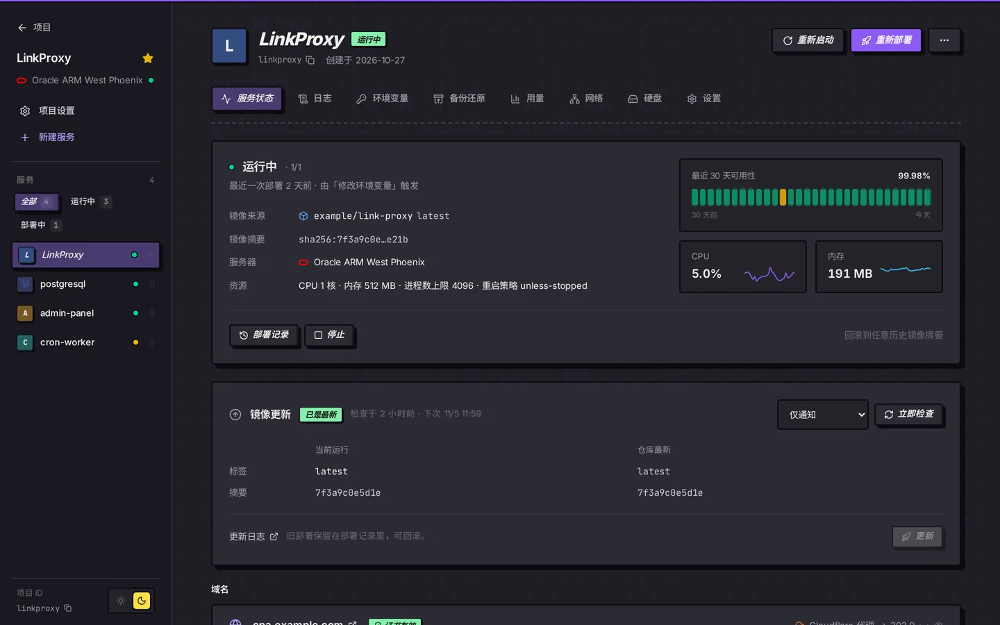
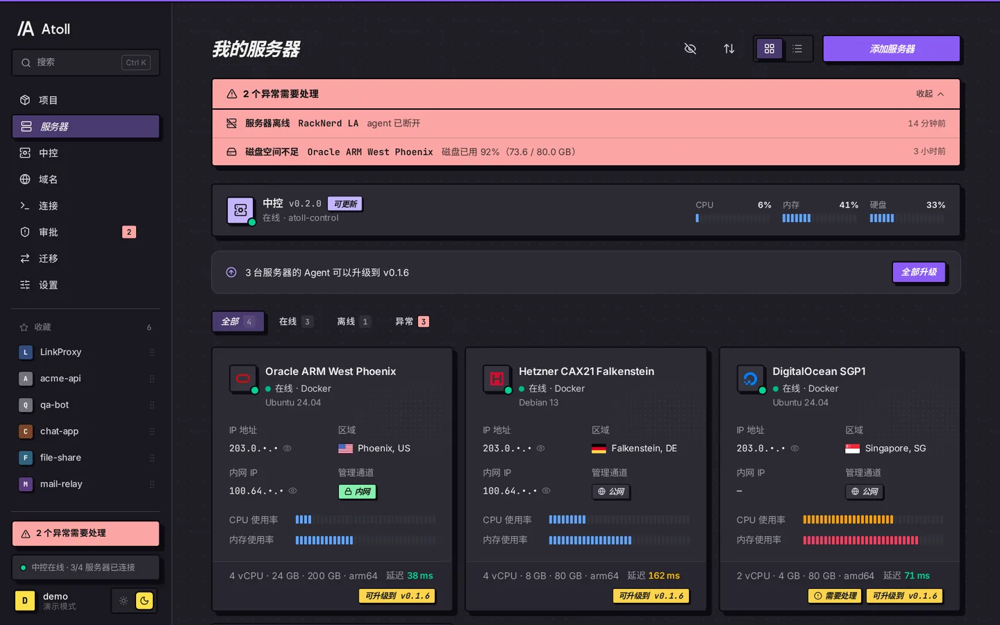
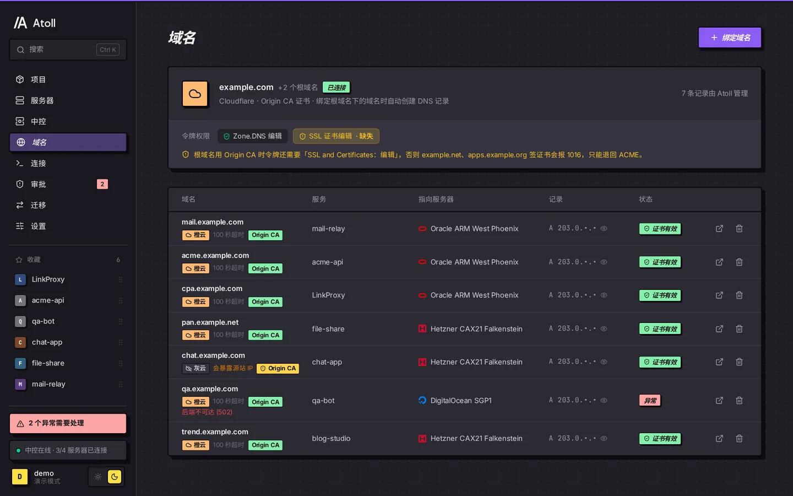
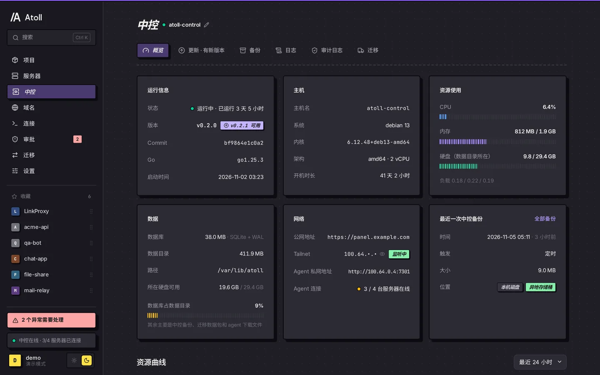
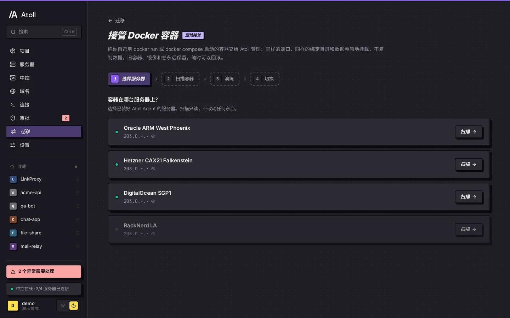
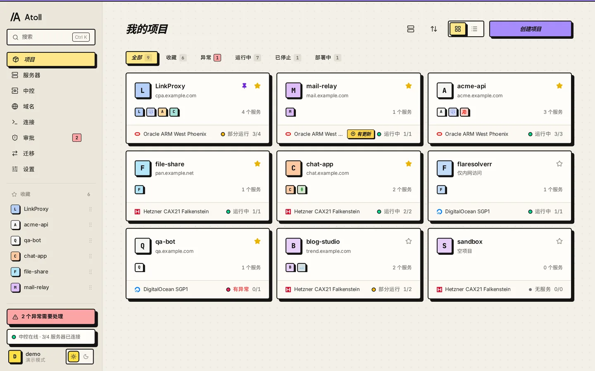

<p align="center">
  
</p>

<h1 align="center">Atoll</h1>

<p align="center">
  <strong>自托管的多 VPS 容器面板：一台轻量中控 + 每台机器一个 agent + 原生 Docker</strong>
</p>

<p align="center">
  简体中文 | <a href="./README.en.md">English</a>
</p>

<p align="center">
  <a href="https://sakuralaaa.github.io/Atoll/"><strong>文档站</strong></a> · <a href="https://sakuralaaa.github.io/Atoll/demo/?demo=1"><strong>在线演示</strong></a> · <a href="./docs/install-docker.md">Docker 安装</a>
</p>

<p align="center">
  <a href="https://github.com/Sakuralaaa/Atoll/releases"></a>
  <a href="./go.mod"></a>
  <a href="./web/package.json"></a>
  
  <a href="./android/README.md"></a>
  <a href="./LICENSE"></a>
</p>

<p align="center">
  
</p>

> [!NOTE]
> **状态：pre-alpha。** 构建和测试在 CI 中通过（含 `-race`），但还没有在大规模生产环境中验证。先在不重要的业务上试用，并开启备份。

> [!TIP]
> 手感参考 Zeabur：从镜像或 Git 仓库部署，图形化管理域名、环境变量、卷、备份和迁移。已经在用 Zeabur 或自己 `docker run` 的服务，可以[原地接管](#迁移与接管)。

## 目录

- [概览](#概览)
- [界面预览](#界面预览)
- [快速开始](#快速开始)
- [迁移与接管](#迁移与接管)
- [管理多台机器](#管理多台机器)
- [从源码构建服务](#从源码构建服务)
- [安全](#安全)
- [日常运维](#日常运维)
- [校验下载的文件](#校验下载的文件)
- [Android 客户端](#android-客户端)
- [开发](#开发)
- [文档索引](#文档索引)
- [社区](#社区)

## 概览

Atoll 由三部分组成：中控 `atoll-server`（API + 内嵌面板 + SQLite）、每台 VPS 上的 `atoll-agent`，以及给人和 AI 用的 `atoll` CLI / MCP。agent 主动用 WebSocket 连回中控，节点不开入站端口；用户流量经各机器自己的 Caddy 直达容器，**中控离线不影响业务**。

### 架构



中控只负责调度和记录；部署、构建、备份都在节点上执行。可选 Tailscale，让中控与节点、跨机器服务之间走私有网络。

### 核心能力

| 模块 | 能力 |
| :-- | :-- |
| 部署 | Docker Hub / GHCR / 私有仓库镜像；GitHub / GitLab / Gitea / 任意 Git 仓库源码构建（push webhook 或轮询自动部署，无 Dockerfile 自动识别）；环境变量跨服务引用；卷、端口、域名；一键回滚；无卷、无宿主机端口的服务零停机部署；新服务默认内存上限 1024 MB |
| 模板 | PostgreSQL / MySQL / Redis / MongoDB |
| 流量 | 每台机器自己的 Caddy 入口；多根域名；绑定子域名时自动建 Cloudflare 记录，橙云 / 灰云一键切换，Origin CA 或 ACME 证书 |
| 迁移 | 服务在机器之间迁移（卷 + 数据库导出恢复）；Zeabur 原地接管；接管 `docker run` / compose 启动的容器 |
| 备份 | restic 直传任意 S3 兼容存储，数据库逻辑导出 + 卷快照；节点本地调度，中控离线照常备份；可恢复到另一台机器 |
| 更新 | 镜像更新检测（digest 与新 semver tag），只提醒或在时间窗内自动更新；中控与 agent 一键升级，失败自动回滚 |
| 中控 | 自身状态、日志、审计；每日加密备份；一条命令迁移中控，业务不停 |
| 面板 | 中文界面，黑夜 / 白天主题；项目收藏、置顶、拖动排序；侧栏导航顺序按账号保存；自定义头像；`Ctrl K` 命令面板；异常集中提示 |
| 自动化 | `atoll` CLI、REST API、`atoll mcp`；按权限细分、可限定项目的 token；危险操作可要求在面板审批 |
| 安全 | 两步验证、防爆破、会话管理、CSP / HSTS；Release 带 SHA256SUMS 与构建来源证明 |

## 界面预览

<table>
  <tr>
    <td width="50%"><p align="center"><sub>服务详情：运行状态、30 天可用性、资源曲线、镜像更新</sub></p></td>
    <td width="50%"><p align="center"><sub>服务器：在线状态、资源、延迟、agent 一键升级</sub></p></td>
  </tr>
  <tr>
    <td width="50%"><p align="center"><sub>域名：Cloudflare 代理、证书状态、令牌权限检测</sub></p></td>
    <td width="50%"><p align="center"><sub>中控：版本、主机、数据库与最近一次备份</sub></p></td>
  </tr>
  <tr>
    <td width="50%"><p align="center"><sub>接管 Docker 容器：选服务器 → 扫描 → 演练 → 切换</sub></p></td>
    <td width="50%"><p align="center"><sub>白天主题</sub></p></td>
  </tr>
</table>

> 截图来自面板内置的演示模式（`?demo=1`），数据均为示例。

## 快速开始

需要：Debian / Ubuntu（amd64 或 arm64）、root 权限、一个解析到中控的域名。

**1. 安装中控**（`--domain` 会装 Caddy 并签发 Let's Encrypt 证书，面板只监听 127.0.0.1）：

```bash
curl -fsSL https://raw.githubusercontent.com/Sakuralaaa/Atoll/main/install/install-server.sh \
  | sudo sh -s -- --domain panel.example.com
```

打开 `https://panel.example.com`，创建管理员账号，然后到「设置 → 安全」开启两步验证。

**2. 添加机器**：在面板「服务器 → 添加」复制命令，到每台 VPS 上运行。命令里带一次性 token（1 小时有效），还带中控所托管 agent 二进制的 SHA-256：

```bash
curl -fsSL https://raw.githubusercontent.com/Sakuralaaa/Atoll/main/install/install-agent.sh | sudo sh -s -- \
  --server https://panel.example.com --token atl_join_xxx --sha256-amd64 … --sha256-arm64 …
```

卸载节点：`curl -fsSL …/install-agent.sh | sudo sh -s -- --uninstall`。它会停掉并删除 agent，容器和数据保留；加 `--purge` 还会删除 Atoll 的容器和网络。`/var/lib/atoll` 里的数据始终保留，不需要时请手动删除。之后在面板里移除这台服务器。

**3. 部署第一个服务**：面板里新建项目，选机器，填镜像（如 `nginx:1`）和端口，再绑定域名。配置了 Cloudflare 的话，DNS 记录会自动创建。

## 迁移与接管

| 来源 | 做法 | 文档 |
| :-- | :-- | :-- |
| Zeabur | 扫描 → 导入 → 演练 → 切换，可回滚，最后卸载 k3s | [docs/migrate-from-zeabur.md](docs/migrate-from-zeabur.md) |
| 自己 `docker run` / compose 的容器 | 同端口、数据原地挂载，旧容器保留可回滚 | [docs/adopt-docker.md](docs/adopt-docker.md) |
| Atoll 内机器之间 | 服务迁移：卷 + 数据库导出恢复 | [docs/api.md](docs/api.md) |
| 中控本身 | 一条命令迁到新机器，业务不停 | [docs/control.md](docs/control.md) |

面板入口在侧栏「迁移」。

## 管理多台机器

机器多了以后，下面几项最常用：

- **加机器**：每台都用面板生成的新命令（token 一次性）。命令里的 `--sha256-*` 让脚本在运行二进制之前先校验，中控用 http 地址时也不会被中间人替换。
- **机器离线**：agent 断线后自动重连，容器由 Docker 管，agent 重启不影响运行中的服务。面板「服务器」页能看到在线状态和资源曲线。
- **中控的负载**：十几台机器的指标和事件都写进中控的 SQLite。写入走单连接，面板的列表、指标和审计查询走独立的只读连接池，不会被写入堵住。
- **构建隔离**：每台机器同一时间只跑一个构建，构建有内存上限和低 CPU 权重，不会拖垮同机的服务（见下一节）。
- **备份**：在「设置 → 备份」配一个 S3 兼容存储桶，所有机器共用。原机器宕机时，可以把备份恢复到另一台。
- **跨机器访问**：开启 Tailscale 后，服务可以用名字访问别的机器上的服务，端口段 `41000–41999`（`ATOLL_MESH_PORTS`）。

### 私有网络（Tailscale，可选）

面板仍走公网 HTTPS，只有中控和节点需要装 Tailscale，你自己的电脑不需要。电脑上同时开着 Tailscale 和 Clash TUN 的，在规则里加 `IP-CIDR,100.64.0.0/10,DIRECT`。

1. Tailscale 后台：ACL 的 `tagOwners` 加 `"tag:atoll": ["autogroup:admin"]`，放行 `tag:atoll` → `tag:atoll:7301,41000-41999`；生成 auth key，选**可复用、非临时、预授权、标签 `tag:atoll`**。
2. 中控：`install-server.sh --domain panel.example.com --tailscale-authkey tskey-auth-xxx [--agent-tailnet-only]`，再到面板「设置 → 私有网络」选 Tailscale，填同一个 key。中控的 tailnet 地址要用 **100.x IP**（节点用 `--accept-dns=false`，解析不了 MagicDNS 名）。
3. 节点：照常运行添加命令。脚本会安装 Tailscale 并经 tailnet 加入，公网地址留作备用。tailnet 不通时会警告并走公网，之后可在「服务器 → 加入 tailnet」或用 `atoll-agent tailnet up` 迁移。

加了 `--agent-tailnet-only`（`ATOLL_AGENT_TAILNET_ONLY=1`）后，公网上的 `/agent/*` 一律返回 404（`/agent/v1/bootstrap` 除外）。自己配 Caddy 的话也要同样处理。详见 [docs/api.md](docs/api.md#private-network-tailscale)。

## 从源码构建服务

```bash
atoll deploy --git https://github.com/OWNER/REPO [--branch main] [--context DIR] [--dockerfile F] \
  [--build-arg K=V] [--git-token-env GH_TOKEN] -p PROJECT
GL_TOKEN=... atoll deploy --git https://gitlab.com/group/app --git-token-env GL_TOKEN -p PROJECT
atoll deploy --git git@git.example.com:me/app.git --ssh-key-file ~/.ssh/deploy_key --poll 5m -p PROJECT
atoll logs SERVICE --build -f
```

支持 GitHub、GitLab、Gitea / Forgejo 和任意 Git 服务器（https 或 SSH）。私有仓库用 Token（https）或只读部署密钥（SSH）；都只写不读、加密保存。SSH 不填 known_hosts 时，第一次构建记住主机密钥，之后变了会拒绝。仓库地址指向本机、内网链路本地或云元数据地址（如 `169.254.169.254`）会被拒绝，构建机先解析域名再把 git 固定到检查过的地址。

构建在服务所在的机器上进行，不在中控上；中控本身不连接你的仓库。新服务只在创建时打印一次推送 webhook 的 URL 和 secret（`atoll services webhook SERVICE` 可再查看 URL），GitHub、GitLab、Gitea/Forgejo 各有对应地址。Webhook 到不了面板时（内网 Git 服务器），用 `--poll` 让服务所在机器定时检查分支。同一个 push 重复投递只会构建一次。

**没有 Dockerfile 也能构建**：默认 `--builder auto`，仓库有 Dockerfile 就用，没有就自动识别 Node（npm / pnpm / yarn）、Bun、Python、Go 或静态站点并生成 Dockerfile（构建日志里能看到生成的内容，面板「检测构建方式」可预览）。识别不准时用 `--stack` 和 `--install-cmd` / `--build-cmd` / `--start-cmd` 覆盖；程序监听 `$PORT`（服务的第一个端口）。暂不集成 Railpack / Nixpacks：它们需要在每台机器上额外安装 BuildKit 前端和较大的二进制，内置识别已覆盖常见技术栈。用到这些新能力需要把节点的 atoll-agent 升级到同一版本，旧 agent 会得到「升级 agent」的提示，原有的 GitHub + Dockerfile 服务不受影响。

**资源限制**：构建默认在一个独立的 BuildKit 容器里运行（buildx `docker-container` driver），内存上限为本机内存的 75%，CPU 权重是普通容器的 1/4，空闲时能用满，忙时让给业务。磁盘剩余不足 3 GiB 时拒绝开始构建，每次构建后把构建缓存修剪到 10 GB。机器上没有 buildx，或拉不到 `moby/buildkit` 镜像时，会自动退回普通 `docker build`，并在构建日志里说明。

要调整这些值，在节点上创建 `/etc/atoll/agent.env`，然后执行 `systemctl restart atoll-agent`：

| 变量 | 默认 | 含义 |
| --- | --- | --- |
| `ATOLL_BUILD_LIMITS` | 开 | 设为 `off` 时用普通 `docker build`，不做限制 |
| `ATOLL_BUILD_MEMORY` | 内存的 75%（至少 1 GiB） | 构建内存上限，如 `2g`、`1536m` |
| `ATOLL_BUILD_CPUS` | 不设硬上限 | CPU 硬上限，如 `1.5` |
| `ATOLL_BUILD_MIN_FREE_GB` | `3` | 低于这个剩余空间时拒绝构建，`0` 表示不检查 |
| `ATOLL_BUILD_CACHE_GB` | `10` | 每次构建后保留的构建缓存，`0` 表示不修剪 |
| `ATOLL_BUILD_CACHE_DAILY_GB` | `5` | 每日清理时保留的构建缓存，`0` 表示每日不修剪 |
| `ATOLL_BUILDER_IDLE_STOP` | `10` | 构建容器空闲多少分钟后停止（缓存保留，下次构建自动启动），也可写 `90s`、`1h`；`0` 表示不停止 |
| `ATOLL_DOCKER_ROOT` | `/var/lib/docker` | 磁盘检查看的路径 |

**清理**：删除服务（或项目、迁走）时，这台机器上该服务的构建镜像 `atoll-build/<服务ID>:*` 和残留的构建目录一并删除。构建容器空闲 10 分钟后自动停止，不占内存；每天清理一次：限制参数改过后留下的旧 `atoll-builder-*` 构建器会被删掉，机器上已没有源码构建的服务时连当前构建器和它的缓存一起删除（下次构建会重新创建），否则把缓存修剪到 5 GB。

1–2 GB 内存的小机器建议设 `ATOLL_BUILD_MEMORY=768m`，或者把构建放到 CI 里，改用镜像部署。

## 安全

面板可以直接放在公网上，靠以下几层保护：

- **HTTPS**：用 `--domain`（Caddy + Let's Encrypt）或你自己的 TLS 反代，面板只监听 127.0.0.1。会话 cookie 是 `HttpOnly` + `Secure` + `SameSite=Strict`，写操作校验 Origin。面板页面带 CSP，HTTPS 下带 HSTS。
- **会话**：最长 30 天，7 天不用自动失效。「设置 → 安全」里可以查看和踢掉会话。
- **两步验证（TOTP）**：「设置 → 安全」里启用，保存好 10 个一次性恢复码。启用和停用都会让其他会话下线。
- **防爆破**：密码和验证码错误按 IP 和账号分别计数，指数退避锁定（IP 最长 1 小时，账号最长 15 分钟）。只信任本机反代的 `X-Forwarded-For`，其他情况用 `--trusted-proxies` 配置。
- **API token（`atl_pat_`）**：只能在面板创建，不走两步验证，按需选最小权限：`read`、`deploy`、`exec`、`delete`、`migrate`、`domains`、`restore`、`servers`、`settings`、`tokens`，还可以限定项目。`exec`（在容器里执行命令）是单独的权限，`deploy` 不包含它。开了 `require_approval` 的 token，危险操作要在面板确认。
- **节点**：agent 主动连出，节点不开入站端口。节点 token 只通过 `Authorization` 头传递，不出现在 URL 里。`public_port` 不能占用 22、7301、41641 和 41000–41999。
- **找回**：忘记密码用 `sudo atoll-server reset-password`；手机和恢复码都丢了用 `sudo atoll-server admin reset-2fa <用户名>`。两条都要在中控机器上执行。

细节见 [docs/api.md](docs/api.md#auth)。

## 日常运维

| 要做的事 | 怎么做 |
| --- | --- |
| 升级中控 | 面板「中控 → 更新」，或重跑 `install-server.sh --version vX.Y.Z` |
| 升级 agent | 面板「服务器」页顶部「全部升级」，或单台服务器「设置 → Agent」；CLI `atoll servers upgrade-agent --all`。校验 SHA-256 后替换，新 agent 两分钟内没连回就自动回滚，容器不重建。v0.1.6 之前的 agent 需要在节点上重跑一次添加命令（已加入的节点会跳过加入步骤） |
| 中控备份和迁移 | 见 [docs/control.md](docs/control.md) |
| 看日志 | `journalctl -u atoll-server -f`、`journalctl -u atoll-agent -f`，或在面板「中控」页查看 |
| 清理磁盘 | 构建镜像每个服务保留最近 3 个；全局清理用 `docker system prune` |

## 校验下载的文件

每个 Release 带 `SHA256SUMS`，还有 GitHub 签发的构建来源证明（provenance），能证明二进制是由本仓库的 release 工作流构建的。

```bash
# 校验哈希
sha256sum -c SHA256SUMS --ignore-missing
# 校验来源（需要 gh CLI）
gh attestation verify atoll-server-linux-amd64 --repo Sakuralaaa/Atoll
```

安装脚本会自动对照 `SHA256SUMS` 校验从 GitHub 下载的二进制；从中控下载 agent 时，对照添加命令里的 `--sha256-*` 校验。中控自更新同样先校验 `SHA256SUMS`，失败自动回滚。

## Android 客户端

[`android/`](android/) 是一个原生 Android 壳应用（Kotlin + Jetpack Compose，Android 8.0+）：原生登录（支持两步验证和恢复码，密码用 Android Keystore 加密保存）、全屏打开面板、会话过期自动重新登录、多个面板快速切换、文件上传下载。

APK 随每个版本附在 [GitHub Release](https://github.com/Sakuralaaa/Atoll/releases) 上（`atoll-android-<版本>.apk`，附 `.sha256`）；`main` 上的开发版在 Actions 的 [android 工作流](https://github.com/Sakuralaaa/Atoll/actions/workflows/android.yml) 里作为 artifact 下载。说明见 [android/README.md](android/README.md)。

## 开发

```bash
# 面板（开发时 npm run dev，设置 VITE_DEMO=1 可用内置演示数据）
(cd web && npm ci && npm run lint && npm run build) && internal/server/webui/sync.sh
# 面板演示模式 E2E（Playwright）
(cd web && npx playwright install chromium && npm run test:e2e)
# 后端
go build ./cmd/atoll-server ./cmd/atoll-agent ./cmd/atoll
go vet ./... && gofmt -l . && go test ./...
# 安装脚本
sh scripts/test-installers.sh
```

CI（[.github/workflows/ci.yml](.github/workflows/ci.yml)）会跑 gofmt、vet、`go test -race`、oxlint、面板构建、演示模式 Playwright E2E、安装脚本测试和 govulncheck（只告警）。所有 action 都固定到 commit SHA。govulncheck 目前只报 `github.com/docker/docker` 的 GO-2026-4887 和 GO-2026-4883，两条都是 Docker 守护进程端的问题（AuthZ 插件、插件权限校验）。Atoll 只用它的客户端，不受影响；等迁到 `github.com/moby/moby/client` 后这两条会消失。

| 组件 | 路径 |
| --- | --- |
| 中控（API + 内嵌面板） | `cmd/atoll-server`、`internal/server`（数据层在 `internal/server/store`，迁移在 `store/migrations`） |
| 节点 agent | `cmd/atoll-agent`、`internal/agent` |
| 共享类型和 agent 协议 | `internal/api`（`types.go` 是 REST 资源，`protocol.go` 是 WebSocket 消息） |
| CLI / MCP | `cmd/atoll`、`internal/cli` |
| Web 面板 | `web/`（React + Vite + Tailwind，页面按路由懒加载） |
| 安装脚本 / systemd | `install/`、`deploy/` |

贡献和 review 约定见 [CONTRIBUTING.md](CONTRIBUTING.md)。发版前在 `docs/releases/<tag>.md` 写好说明和升级步骤（会附在 Release 上），再在 [CHANGELOG.md](CHANGELOG.md) 加一行。推送 `v*` tag 会触发 [release 工作流](.github/workflows/release.yml)，构建、测试、打包、签发 provenance 并发布 Release：

```bash
git tag v0.1.0 && git push --tags
```

## 文档索引

- [文档站](https://sakuralaaa.github.io/Atoll/)（由 `docs/` 生成）· [在线演示](https://sakuralaaa.github.io/Atoll/demo/?demo=1)
- [docs/README.md](docs/README.md)：文档总览；[快速开始](docs/quick-start.md) · [功能概览](docs/features.md) · [运维参考](docs/operations.md) · [故障排查](docs/troubleshooting.md) · [常见问题](docs/faq.md)
- [docs/api.md](docs/api.md)：REST API、agent 协议、权限、备份、构建
- [docs/control.md](docs/control.md)：中控的备份、自更新、迁移、灾难恢复
- [docs/compatibility.md](docs/compatibility.md)：版本兼容与升级承诺（stable/beta 通道、直升、降级、中控与 agent 版本差）
- [docs/security-review-2026-11.md](docs/security-review-2026-11.md)：2026-11 安全自审：检查项、已修问题与遗留风险
- [docs/install-docker.md](docs/install-docker.md)：用 Docker / Compose 运行中控
- [docs/migrate-from-zeabur.md](docs/migrate-from-zeabur.md)：从 Zeabur 迁移
- [docs/adopt-docker.md](docs/adopt-docker.md)：接管自己用 Docker 启动的容器
- [docs/ui-guide.md](docs/ui-guide.md)：面板界面约定
- [CHANGELOG.md](CHANGELOG.md)：版本记录
- [ROADMAP.md](ROADMAP.md)：路线图

## 社区

欢迎来 [LINUX DO](https://linux.do) 交流和反馈。

- Bug 和功能请求：使用 [Bug 模板](https://github.com/Sakuralaaa/Atoll/issues/new?template=bug_report.yml) 或 [功能请求模板](https://github.com/Sakuralaaa/Atoll/issues/new?template=feature_request.yml)
- 安全漏洞：按 [SECURITY.md](SECURITY.md) 使用 GitHub 私密漏洞报告，不要公开提交漏洞细节
- 参与贡献：[CONTRIBUTING.md](CONTRIBUTING.md) · [行为准则](CODE_OF_CONDUCT.md)

## License

[AGPL-3.0](LICENSE)。部分 Kubernetes 投影规则移植自 [zeabur-oss/zeabur](https://github.com/zeabur-oss/zeabur)（Apache-2.0），见 [THIRD_PARTY_NOTICES.md](THIRD_PARTY_NOTICES.md)。
